# VCMI Future Vision Launcher

A standalone external desktop launcher **compatible with VCMI configurations**, with a "Future Vision" interface style.

A better mod management panel (supports visualizing and picking town mods).

A better game settings panel (supports viewing VCMI configurations at different tiers).

Provides a **Realm** system that isolates (mod combination + saves + settings + maps) as a whole into multiple non-interfering game environments, which can be packaged and distributed to others.

Provides a **Wiki** system to view game illustrations and data without running the game.

## Features

### Realm System

Implements multiple isolated (mod combination + saves + settings + maps) game environments.

#### Realm Intro Presentation

Launching the launcher enters the realm's intro presentation (wallpaper / video / theme music / story description), providing a better narrative experience.

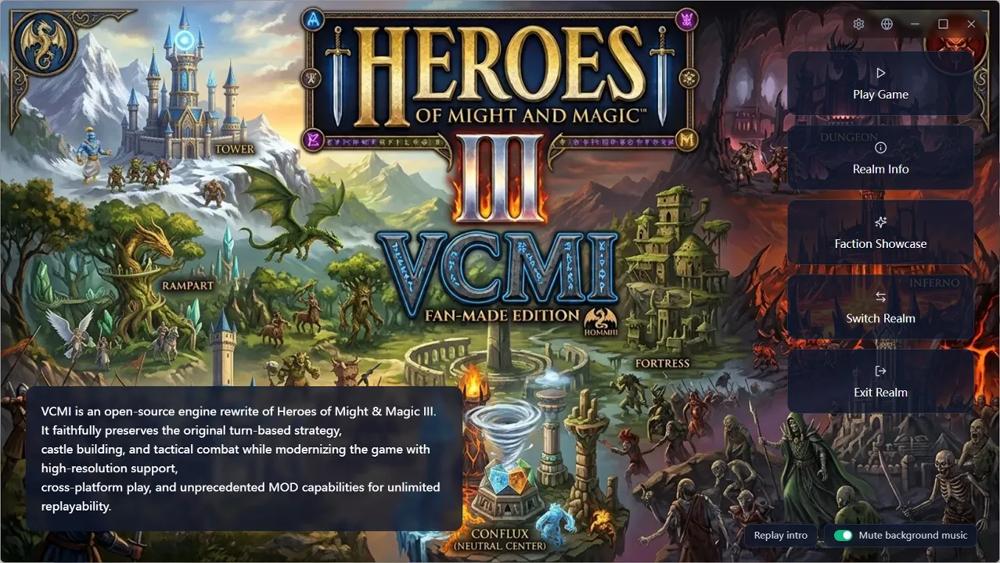

#### Faction Showcase

After entering a realm, a full-screen slideshow presentation can play, sequentially showing each faction's backdrop, creature dens, heroes, and theme music.

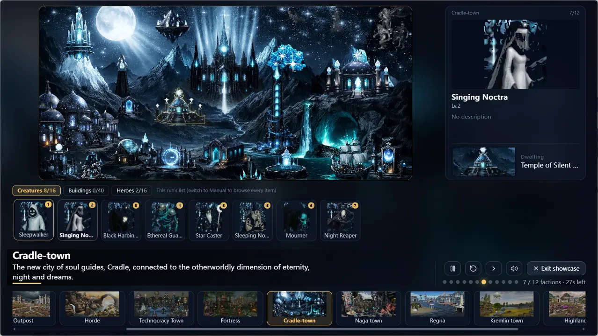

#### Local Realm Switching

You can switch between locally installed realms, or directly import realms distributed as `.vcmirealm` by others.

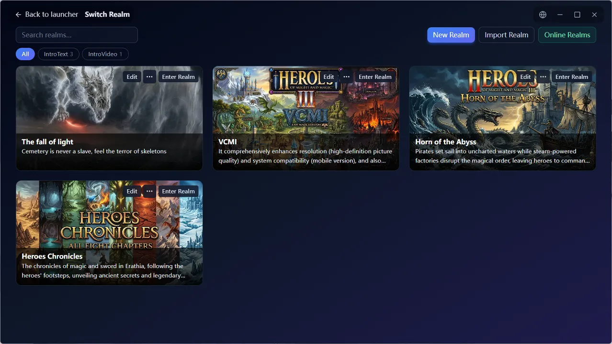

#### Remote Realm Repository

Subscribe to realms made by others like subscribing to mods, download and install with one click, with update notifications.

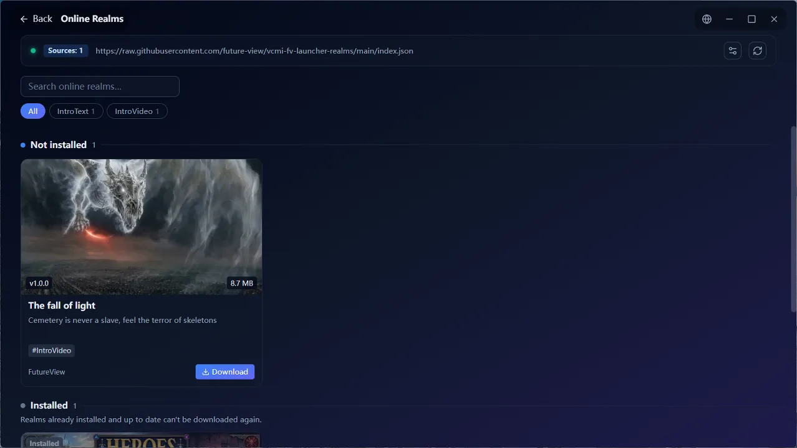

#### Realm Editor

Customize your realm like editing a "game plan", then package and publish it.

- Basic info: multilingual name, description, tags, author, version
- Intro presentation: wallpaper, cover, theme music, intro video / music, duration, skippable or not
- Mod combination: reuse the main-interface selection method, automatically solve dependencies, one-click completion
- Map management: import, upload, move, delete, filtered by language
- Faction showcase config: auto-arrange or manually arrange the deck
- Advanced options: each of the five directories can be set individually to "follow global" or "realm-independent", config files can be shared or private
- Export as a `.vcmirealm` package
- Preview the current realm

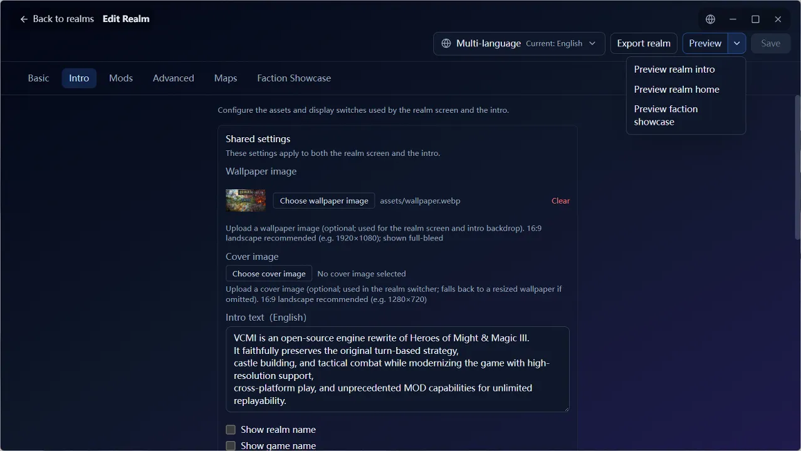

### Mods View

#### Mod Presets

Save a satisfying mod combination as a preset, switch with one click anytime, and share it with others.

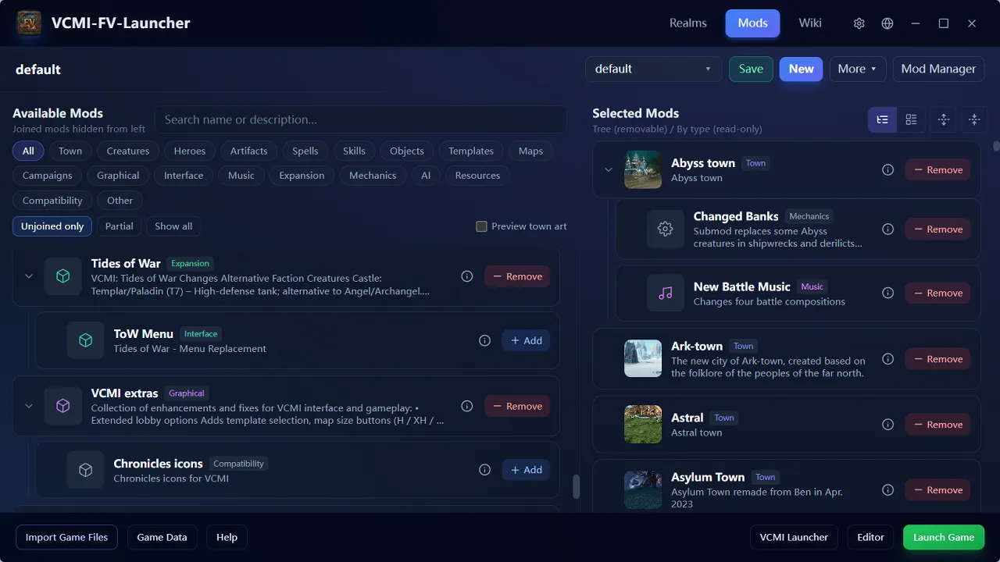

Supports displaying each town's background, improving the friendliness of mod preset configuration.

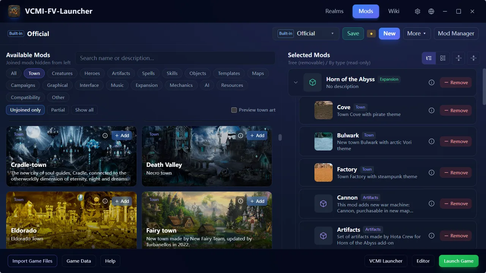

#### Mod Management

Browse, install, update, and uninstall mods directly from the official VCMI mod repository, no longer needing manual download and unzip.

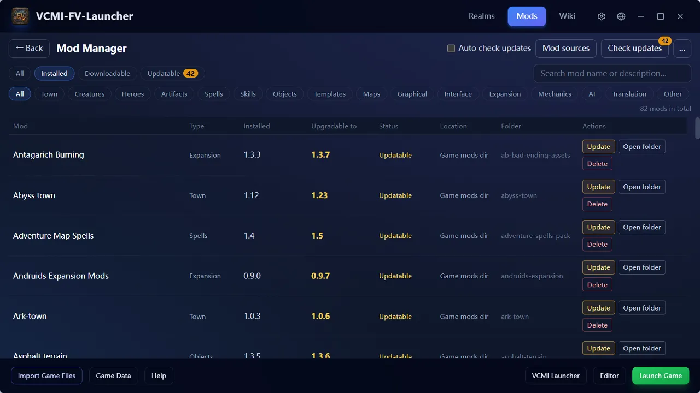

### Wiki

Offline browsing of 9 categories (towns / creatures / heroes / buildings / artifacts / spells / skills / terrains / mods), with right-click hover overlay support.

- Search by Chinese name, English name, or entry ID
- Each category has a customized presentation: factions include backdrop plus creature / building / hero overview, creatures have battle animations, heroes have biography and specialty
- Hover over any entry name to pop up an info overlay; entries link to each other
- Data updates automatically as mods change; fully usable offline

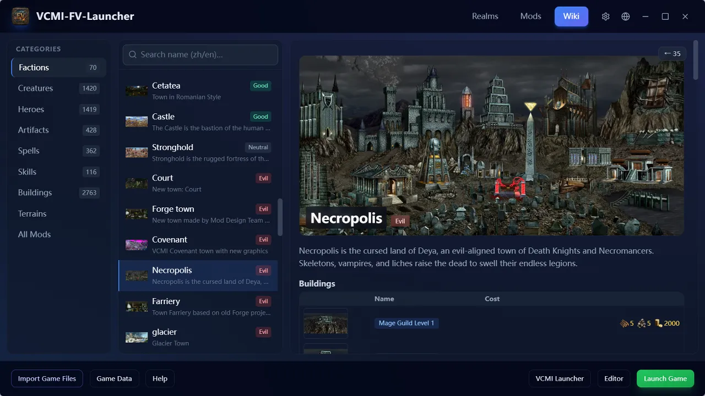

**HD Assets**: Wiki images and town backdrops are automatically presented in a clearer way. Supports `official HD assets`, `image HD upscaling`, and `AI super-resolution upscaling`.

### Settings Panel

Fully includes official VCMI settings, presented as cards with explanations, taking effect immediately after changes.

- Multiple config groups: General, Video, Adventure Map, Combat, Game Tweaks, AI, Input, Launcher, Mods, Server, Network, Logs, plus the launcher's own settings
- Three display tiers: common / advanced / all, with toggleable detailed descriptions
- Top search to quickly locate settings
- Settings show a "shared globally / realm-only" badge

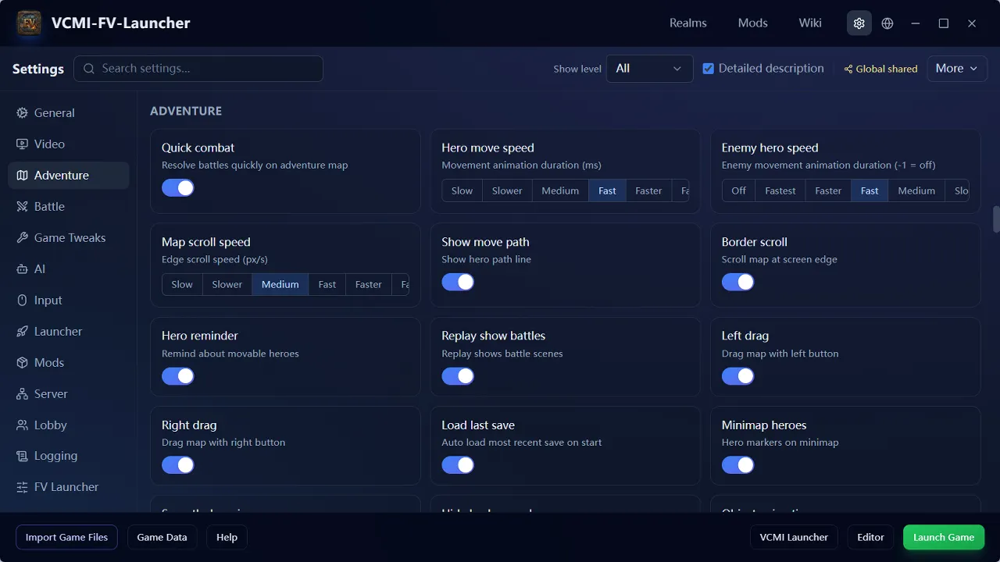

### Other Capabilities

#### Languages

The interface, wiki entries, and built-in help all follow the language you choose.

- The interface supports multiple languages
- Wiki entries use the current language, falling back to English automatically when missing
- Switching the interface language syncs the in-game language
- After switching languages, the corresponding language pack is automatically recognized and prompted for activation

#### Game File Import

Drag scattered maps, saves, mod archives, and HD assets directly into the window, and the launcher automatically determines the type and places it in the correct location.

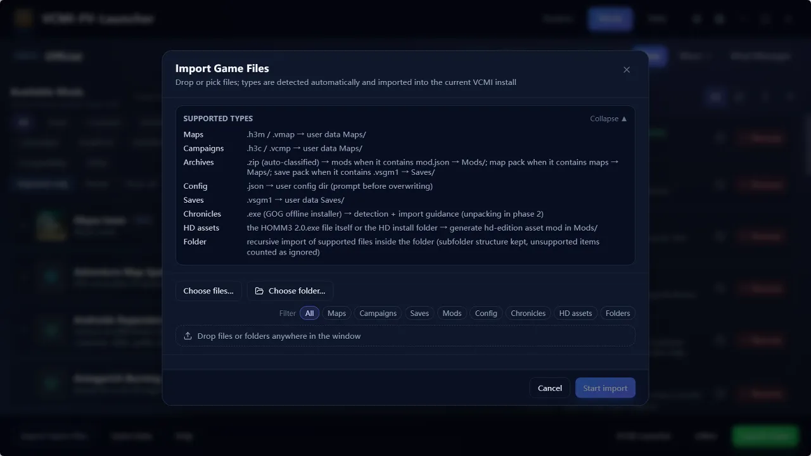

#### First-Run Setup Wizard

On first open, it guides you through the necessary preparation: choose the interface language, locate the `Heroes of Might and Magic III` game directory (auto-detected, with manual selection on failure), confirm the user data directory, and enter the main interface after validation passes.

#### Launcher Auto-Update

After a new version is released, it is automatically checked and prompted; the update process completes automatically without affecting your data.

#### Portable Distribution

Any distributor can achieve more **portable runtime** effects by pre-configuring relevant `launcher.json` settings.

- Pre-set `paths.*` path config (supports relative paths) to skip the `First-Run Setup Wizard`.
- Pre-set `realms.active` to build in a default realm, so the realm intro presentation plays on first open.
- Pre-set `realms.repository_urls` to build in a realm repository.
- Pre-set `network.*` to configure network proxy, providing access success rates in different network environments.

## Tech Stack

- Frontend: React 18 + TypeScript + Tailwind CSS 3.4 (Vite 5, glassmorphism dark theme)
- Desktop shell: Tauri 2 (Rust), spawning `VCMI_client.exe` / `VCMI_mapeditor.exe`
- Zip: yauzl on TS side; zip crate on Rust side

## Development

```bash
# Install dependencies
npm install

# Frontend mock run (browser, no Tauri)
npm run dev

# Type check + build web bundle
npm run build

# Preview build artifact (run after build)
npm run preview

# Tauri desktop run (real machine)
npx tauri dev

# Build Windows exe
npx tauri build
```

> More commands (verification, debug builds, wiki cache, version/release, etc.) are in [docs/guides/build-and-run.md](docs/guides/build-and-run.md).

## Build Artifacts

- Windows exe: `src-tauri/target/release/vcmi-fv-launcher.exe`
- Windows msi: `src-tauri/target/release/bundle/msi/*.exe`
- Windows nsis: `src-tauri/target/release/bundle/nsis/*.exe`

## Design Documents

**Full index:**

- [docs/README.zh-CN.md](docs/README.zh-CN.md) (Chinese)
- [docs/README.md](docs/README.md) (English)

**Document types:**

- `docs/architecture/` — overview, frontend architecture, backend architecture, IPC contract, persistence layout
- `docs/features/` — one document per feature domain (mods / wiki / realms / settings / HD / updates …)
- `docs/guides/` — build & run, release, portable deployment, distribution build, repository index, icon replacement
- `docs/reference/` — VCMI directory mechanics, error codes, preset format
- `docs/decisions/` — architecture decision records (ADR)
